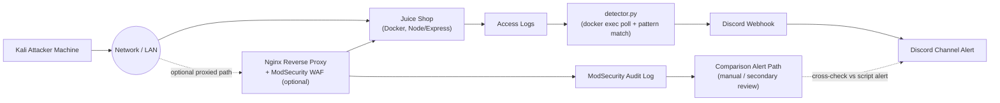

# Detection & Remediation Report — Live Wire, Purple Rain

*Blue Team Lead deliverable — real-time attack detection, alerting pipeline, and source-level remediation for the "Live Wire, Purple Rain" Red/Blue/Purple team exercise against a self-hosted OWASP Juice Shop.*

---

## 1. Architecture

**Primary detection path:** Kali attacker → network → Juice Shop (Docker/Node) → access logs → `detector.py` (polling the container every 2s via `docker exec`, substring pattern matching) → Discord webhook → Discord channel alert.

**Secondary/comparison path (optional):** traffic routed through an Nginx reverse proxy running ModSecurity, which logs matched rules to its own audit log, used to cross-check the custom script's detections.

---

## 2. Methodology

This exercise follows a closed-loop, Purple Team methodology executed per attack technique. First, the Red Team Lead executes the exploit against the live Juice Shop instance. Second, the Blue Team Lead observes the detection pipeline in real time and measures detection latency — the elapsed time between the attack request hitting the application log and the corresponding Discord alert arriving. Third, based on the confirmed gap (or confirmed detection), a source-level remediation is applied directly to the Juice Shop/application code or configuration. Finally, the identical attack payload is re-run against the patched application to confirm the exploit now fails (or is blocked) and, where applicable, that detection still fires correctly on the retry. Every cycle — exploit, detection timestamp, remediation diff, and re-test outcome — is logged with timestamped evidence so the full before/after story is reproducible.

---

## 3. Attack–Detection–Remediation Matrix

> **All cells other than "Attack Type" and "Technique/Payload" are placeholders.** Do not fill in Y/N, latency, or results until the attack has actually been executed against the live environment and the real alert/log evidence has been captured. No numbers below are real measurements.

| Attack Type | Technique/Payload | Detected? (Y/N) | Detection Latency (s) | Alert Source (Script/WAF) | Remediation Applied | Re-test Result |
|---|---|---|---|---|---|---|
| SQL Injection | Login bypass: `' OR 1=1--` | [fill in] | [fill in] | [fill in] | [fill in] | [fill in] |
| Reflected XSS | Search field: `` | [fill in] | [fill in] | [fill in] | [fill in] | [fill in] |
| Stored XSS | Product review: `` | [fill in] | [fill in] | [fill in] | [fill in] | [fill in] |
| IDOR | `/rest/basket/:id` tampering (basket ID substitution) | [fill in] | [fill in] | [fill in] | [fill in] | [fill in] |
| Broken Authentication | JWT weak secret (brute-forced/guessed signing key) | [fill in] | [fill in] | [fill in] | [fill in] | [fill in] |
| BOLA | `/api/Users/:id` — accessing another user's object by ID | [fill in] | [fill in] | [fill in] | [fill in] | [fill in] |
| JWT Algorithm Confusion | `alg:none` header tampering | [fill in] | [fill in] | [fill in] | [fill in] | [fill in] |

---

## 4. Detection Layer

The primary detection mechanism is a custom Python script (`../detection/detector.py`) that polls the running Juice Shop Docker container every 2 seconds via `docker exec`, reads its current access log file, and checks each not-yet-seen line against a pattern list to flag known attack indicators — SQLi tokens (`UNION SELECT`, `' OR`), XSS payloads (`<script`, `onerror=`, `alert(`), and ID-bearing endpoint access (`/rest/basket/`, `/api/Users/`). On a match, the script posts a timestamped alert to a Discord channel via an incoming webhook. A more elaborate alternate implementation (true incremental log tailing, regex signatures including JWT `alg:none` detection and path traversal, per-line dedup/rate-limiting) is kept as a reference/fallback at `../detection/alternate-log_watcher/`. As an optional secondary layer, ModSecurity rules (`../detection/modsecurity/juiceshop-rules.conf`) were written for deployment in front of Juice Shop via an Nginx reverse proxy to provide a WAF-based comparison signal, letting the team sanity-check the custom script's detections against an industry-standard rule engine's audit log.

---

## 5. Remediation Summary

Full before/after code diffs and configuration changes for every fix applied in this exercise are documented in `../remediation/patches.md`. At a high level, the remediation work falls into four categories: (1) replacing raw/concatenated SQL queries with parameterized queries to eliminate SQL injection; (2) adding output encoding and a Content Security Policy (CSP) to neutralize reflected and stored XSS; (3) adding explicit ownership/authorization checks on object-access endpoints (basket, user profile) to close IDOR and BOLA gaps; and (4) enforcing a server-side JWT algorithm allowlist (and replacing the weak signing secret) to prevent `alg:none` confusion attacks and brute-forced-secret authentication bypass.

---

## 6. Known Limitations

- Detection based solely on access logs cannot fully correlate IDOR/BOLA activity — confirming that a request accessed *another* user's object requires session/identity context that the application layer has but the raw access log does not, so some of these detections rely on manual/contextual confirmation rather than the regex signature alone.
- `log_watcher.py` is a lightweight, purpose-built script for this exercise, not a production-grade SIEM — it has no persistent alert history, no multi-host correlation, and no tuning/false-positive suppression beyond basic rate-limiting.
- The ModSecurity/Nginx WAF layer was a time-boxed, optional addition used for comparison purposes only; its rule set was not hardened or tuned to production standards within the scope of this project.

---

## 7. [fill in: Executive summary]

*Student completes this section after all live attacks have been executed: summarize overall detection coverage, the most significant gap found, and the single most important remediation applied.*

---

## 8. [fill in: Screenshots/evidence appendix]

*Student completes this section after the live run: attach Discord alert screenshots (with timestamps), relevant log_watcher.py console/log output, before/after request-response captures (e.g. Burp/curl), and ModSecurity audit log excerpts if used.*
